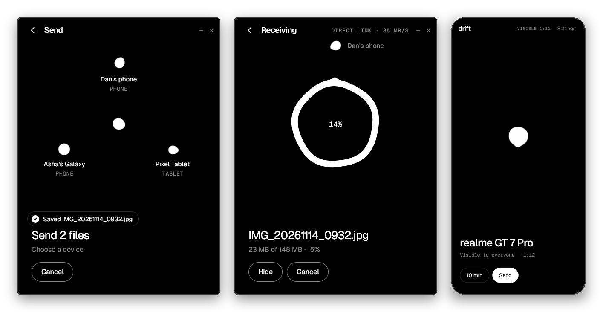

# Drift

Quick Share for Windows, made to be quick.

Drift sends files between your PC and any Android phone using Google's Quick Share protocol, so it works with the share sheet you already have. When both sides run Drift, it skips your Wi-Fi network and opens a direct link between the two devices instead, which in my tests runs at whatever the radio can carry (50–60 MB/s on 5 GHz).

<p align="center"></p>

## Get it

Grab the latest build from [Releases](https://github.com/dan-el-7/drift/releases/latest).

- **Windows 10 or 11 (64-bit):** run `Drift-win-Setup.exe`. It isn't code-signed yet, so SmartScreen will warn you. Click **More info → Run anyway**.
- **Android 12 or newer (optional):** install `Drift-android.apk` and allow installs from your browser or file manager when asked. You don't need it to receive from a phone, since stock Quick Share talks to Drift fine. It's what turns on the fast direct link.

## Using it

- **Receive.** Leave Drift open (or in the tray). On the phone, share something → Quick Share → pick your PC. Check the code matches, then accept.
- **Send.** Drop files onto the window, or click **Send files**, and tap a device.
- **Trust a device.** On a request from a Drift device, choose **Always accept** and it won't ask again.
- **On Android** there's a Quick Settings tile that makes you visible for 10 minutes, and Drift shows up in the share sheet and in "Open with".

If something gets stuck, Settings has **Restart Bluetooth** (on the PC) and a Wi-Fi Direct **Reset pairing** (on both). Turning Bluetooth off and on fixes most of the rest.

Quit Google's own Quick Share app on the PC while using Drift, or phones may find it instead.

## If something goes wrong

Grab the log right after it happens. Drift starts a fresh one each time it opens, so restarting first loses it.

**Windows** (PowerShell): copies it to your Desktop.

```powershell
Copy-Item "$env:APPDATA\Drift\core.log" "$HOME\Desktop\drift-pc.log"
```

**Android**: plug the phone in with USB debugging on, then:

```sh
adb shell run-as app.drift cat files/core.log > drift-phone.log
```

Open an [issue](https://github.com/dan-el-7/drift/issues) with what you did and attach the logs. They include your device names and local IP addresses, so look them over before posting.

<sub>(You can tap the button on the bottom left to share logs on the Android client with ease, desktop logs live in %APPDATA%\Drift\core.log for Windows)</sub>

## Building

You'll need Rust (stable), the .NET 10 SDK and, for the phone app, Android Studio's SDK + NDK and [`cargo-ndk`](https://github.com/bbqsrc/cargo-ndk) (`rustup target add aarch64-linux-android`).

```sh
cargo build --release -p drift-ffi                     # the core
dotnet build ui/windows -c Release -p:Platform=x64      # the Windows app; copy target/release/drift_ffi.dll next to Drift.exe
cd android && ./gradlew assembleDebug                   # the Android app (builds the core through cargo-ndk)
```

`installer/release.ps1` builds the Windows installer with [Velopack](https://velopack.io). `cargo run -p drift` is a small command-line client that's handy for poking at the protocol.

## Thanks

Drift is its own implementation, but it wouldn't exist without the people who figured out Quick Share first:

- [NearDrop](https://github.com/grishka/NearDrop) by grishka, whose write-up of the protocol made all of this approachable.
- [rquickshare](https://github.com/Martichou/rquickshare) by Martichou, for showing a Rust take on it.
- The protocol definitions in `proto/` come from Google's [nearby](https://github.com/google/nearby) and [ukey2](https://github.com/google/ukey2) (Apache 2.0).
- [Geist](https://vercel.com/font) by Vercel for the type (OFL).

Not affiliated with Google. Quick Share is a trademark of Google LLC.

## License

[Apache 2.0](LICENSE). See [NOTICE](NOTICE) for third-party bits.
